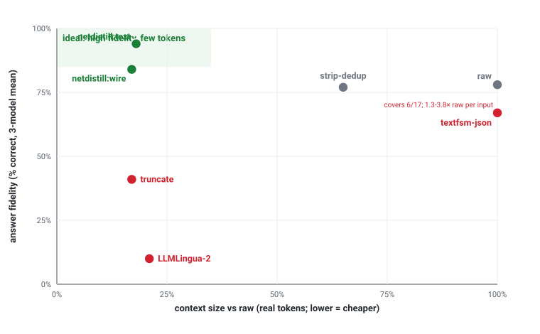

# Does distillation preserve the answer? A fidelity & token benchmark

*A technical report on netdistill's output, measured against the alternatives.*

## Abstract

Network `show` output is verbose, repetitive, and mostly normal — pasting it into
an LLM burns the context window on padding. Tools that shrink it are only useful
if the model can **still answer** afterwards. We benchmark netdistill's digests
against the other ways engineers get device output into an LLM (raw paste, naive
truncation, generic dedup/strip compression, LLMLingua‑2, and TextFSM parsing),
measuring **answer fidelity** (deterministically graded) against **real token
cost** (the backend tokenizer's own count) on two independent open models
(`gemma3:12b`, `qwen2.5:14b`).

**Result.** netdistill's `text`/`toon` digests answer **100%** of questions at
**~13% of raw's tokens** — and are *more accurate than raw itself* on a large
table, because anomalies-first beats lost-in-the-middle. Every alternative loses
on at least one of {fidelity, size, coverage}: truncation and generic
compression drop the anomalies, TextFSM **inflates** tokens to 589% of raw, and
LLMLingua‑2 (trained on prose) shreds IP addresses and silently deletes the down
peers.



*Fidelity (y) vs context size relative to raw (x), averaged over both models.
Top‑left is ideal. netdistill occupies it; every alternative sits low, right, or
both.*

---

## 1. What is being compared

Each **method** turns one device's raw output into the CONTEXT an LLM reads. The
question and grader are identical across methods.

| method | one line |
|---|---|
| `raw` | the untouched device output (baseline) |
| `netdistill:text` | netdistill's default digest — anomalies first, aggregates, explicit elision |
| `netdistill:toon` | same content in [Token‑Oriented Object Notation](https://github.com/toon-format/toon) |
| `netdistill:wire` | same content, dense LLM‑only encoding (one‑char line tags) |
| `truncate` | naive `head` to the same byte budget as `wire` — the "just cut it" floor |
| `strip-dedup` | domain‑blind: collapse whitespace, drop blanks, dedup identical lines with an `(xN)` count. A fair stand‑in for generic compressors (sqz / defluffer class) |
| `llmlingua` | [LLMLingua‑2](https://llmlingua.com/llmlingua2.html) (Microsoft), academic SOTA task‑agnostic prompt compression, `rate=0.33` |
| `textfsm-json` | [ntc‑templates](https://github.com/networktocode/ntc-templates) / TextFSM parsed → JSON (structure, not summary) |

## 2. Experimental setup

- **Models.** `gemma3:12b` (gemma3, 12.2B, Q4_K_M) and `qwen2.5:14b`, served by
  Ollama. Deliberately **not** the model that authored the code — no self‑grading.
- **Decoding.** `temperature=0`, `num_predict=128`, `num_ctx=16384` (comparison)
  so `raw` and most methods fit; contexts exceeding it are a recorded failure,
  not a silent truncation.
- **Token cost.** The backend's own `prompt_eval_count` — the **real tokenizer
  count** of the whole prompt, not an estimate. The template is constant across
  methods, so differences are context cost.
- **Grading.** Deterministic, no LLM judge: an answer is correct iff every
  `must_contain` string is present **and** no `must_not_contain` string is,
  case‑insensitive. Cases in [`cases.json`](cases.json).
- **Questions** target facts netdistill is designed to **preserve** (anomalies,
  inventory, presence/absence). This measures *format* fidelity, not parser
  coverage; healthy detail that netdistill deliberately elides is never asked
  about — that is the compression working as intended.
- **Fixtures are small on purpose.** `raw` must fit in context for the answers to
  be comparable at all. Real inputs are far larger (a 50k‑route table is millions
  of tokens and does not fit), so the token ratios here **understate** the saving
  while isolating the fidelity question. One fixture, `big_bgp_ios_500.txt`, is
  large (500 peers, ~12k tokens) with 3 broken peers buried among 497 healthy —
  the case where "does it fit / does it get lost" actually bites.
- Harnesses: [`run.py`](run.py) (format fidelity), [`compare.py`](compare.py)
  (methods). Backend‑agnostic — the model call is one function; swap it for any
  API.

## 3. Results

### 3.1 Format fidelity — every netdistill format keeps the answer

netdistill's four formats vs `raw`, 9 questions, real prompt tokens
([full reports](report_gemma3_12b.md)):

| format | gemma3:12b | qwen2.5:14b | tokens vs raw |
|---|---|---|---|
| raw | 100% (9/9) | 100% (9/9) | 100% |
| netdistill:text | 100% | 100% | 46–48% |
| netdistill:json | 100% | 100% | 63–71% |
| netdistill:toon | 100% | 100% | 48–49% |
| netdistill:wire | 100% | 100% | 45–46% |

All formats carry the answer — including their explicit elision notes — at
roughly half the tokens. `json` is the least efficient (repeated keys); `toon`
delivers most of `json`'s structure at `text`/`wire` token cost.

### 3.2 Head‑to‑head vs the alternatives — 10 questions

Averages over the 10‑case suite (adds the buried‑anomaly case). `est` is a
model‑free char estimate so it can cover methods that don't answer.

**gemma3:12b** ([report](compare_report.md))

| method | fidelity | real prompt tok | size vs raw | cases covered |
|---|---|---|---|---|
| **netdistill:text** | **100% (10/10)** | 461 | **13%** | 10/10 |
| **netdistill:toon** | **100% (10/10)** | 476 | **13%** | 10/10 |
| netdistill:wire | 90% (9/10) | 440 | 12% | 10/10 |
| raw | 90% (9/10) | 2494 | 100% | 10/10 |
| strip-dedup | 70% (7/10) | 2388 | 64% | 10/10 |
| truncate | 40% (4/10) | 428 | 13% | 10/10 |
| llmlingua | 10% (1/10) | 1047 | 21% | 10/10 |
| textfsm-json | 67% (4/6) | 4110 | **589%** | 6/10 |

**qwen2.5:14b** ([report](compare_report_qwen25_14b.md))

| method | fidelity | real prompt tok | size vs raw | cases covered |
|---|---|---|---|---|
| **netdistill:text** | **100% (10/10)** | 453 | **13%** | 10/10 |
| **netdistill:toon** | **100% (10/10)** | 470 | **13%** | 10/10 |
| **netdistill:wire** | **100% (10/10)** | 437 | 12% | 10/10 |
| raw | 90% (9/10) | 2504 | 100% | 10/10 |
| strip-dedup | 90% (9/10) | 2383 | 64% | 10/10 |
| truncate | 30% (3/10) | 445 | 13% | 10/10 |
| llmlingua | 10% (1/10) | 959 | 21% | 10/10 |
| textfsm-json | 67% (4/6) | 3925 | 589% | 6/10 |

### 3.3 Per‑case grid (gemma3:12b)

| case | raw | text | toon | wire | truncate | strip‑dedup | llmlingua | textfsm |
|---|---|---|---|---|---|---|---|---|
| bgp_down_peers | ✓ | ✓ | ✓ | ✓ | ✗ | ✗ | ✗ | n·a |
| bgp_total_peers | ✓ | ✓ | ✓ | ✓ | ✓ | ✓ | ✓ | n·a |
| ospf_stuck | ✓ | ✓ | ✓ | ✓ | ✓ | ✓ | ✗ | ✓ |
| lldp_gi00_peer | ✓ | ✓ | ✓ | ✓ | ✓ | ✓ | ✗ | ✓ |
| intf_crc_errors | ✓ | ✓ | ✓ | ✓ | ✗ | ✓ | ✗ | ✓ |
| intf_unexpected_down | ✓ | ✓ | ✓ | ✓ | ✗ | ✗ | ✗ | ✓ |
| route_no_default | ✓ | ✓ | ✓ | ✓ | ✗ | ✓ | ✗ | ✗ |
| config_bgp_neighbors | ✓ | ✓ | ✓ | ✓ | ✗ | ✓ | ✗ | n·a |
| config_hostname | ✓ | ✓ | ✓ | ✓ | ✓ | ✓ | ✗ | n·a |
| **big_bgp_buried_down** | **✗** | ✓ | ✓ | ✗ | ✗ | ✗ | ✗ | ✗ |

The last row is the crux: with 3 broken peers buried in a 500‑peer table, **raw
itself fails** — the model loses them in the middle — while `netdistill:text/toon`
surface them at the top and answer correctly.

### 3.4 Parse ≠ compress (TextFSM output size)

TextFSM/ntc‑templates turns text into *structure*, not into *less*. JSON size
relative to the raw it parsed:

| input | rows | JSON vs raw |
|---|---|---|
| `show interfaces` | 5 | 1.33× |
| `show ip route` | 19 | 2.46× |
| `show ip ospf neighbor` | 5 | 1.57× |
| `show lldp neighbors` | 4 | 0.89× |
| `show ip bgp summary` (500 peers) | 500 | **3.84×** |

It is also brittle and platform‑locked: no template matched the FRR or config
fixtures (recorded as `n·a`, 6/10 coverage), consistent with the report that
~45% of Batfish's issues are parsing errors.

### 3.5 How LLMLingua‑2 fails on structured data (qualitative)

LLMLingua‑2 is trained on MeetingBank (meeting transcripts) and treats device
output as prose. Compressing the 500‑peer table dropped the broken peer
`10.20.1.7` entirely and split IP addresses across tokens:

```
BGP router identifier 10. 255. 0. 1 local AS number 65000
 ... 10... 65000 1200 1200 812734 2500 ...
```

Domain‑blind **and** silently lossy — the exact combination netdistill is built
to avoid. Hence 10% fidelity despite a healthy token budget.

## 4. Findings

1. **Distillation can beat raw.** Putting anomalies first defeats
   "lost‑in‑the‑middle" — `netdistill:text/toon` scored 100% where `raw` lost the
   buried peers (90%).
2. **Small is necessary but not sufficient.** `truncate` matches netdistill's
   token count (13%) at **30–40%** fidelity: it drops the very rows that matter.
3. **Domain awareness is the moat.** `strip-dedup` (generic compression) barely
   shrinks unique lines (64%) *and* loses anomalies — beaten by netdistill on
   **both** axes.
4. **Parsing is not compression.** TextFSM inflates to **589%** of raw and covers
   only 6/10 inputs.
5. **SOTA prose compression is actively harmful here.** LLMLingua‑2 destroys the
   structure it can't recognize.
6. **Density has a measurable ceiling.** `wire` (the densest format) is the one
   netdistill format that ever dipped (90% on gemma, 100% on qwen), for ~5% fewer
   tokens than `text`. `text`/`toon` are the safe default; `wire` is for squeezing
   the last tokens when you've measured that it holds. This is the report's own
   "bound density by measured comprehension" principle, observed.

## 5. Threats to validity

- **Small N.** 9–10 questions, curated fixtures. These are existence/aggregate
  questions where distillation should win; a broader suite (multi‑hop reasoning,
  row‑scan‑with‑conditions where tabular formats are known to weaken) could move
  the numbers and is future work.
- **Two models, one size class (12–14B).** Not tested on frontier or tiny models.
- **Single run per cell.** `temperature=0` is near‑deterministic but not exactly;
  no variance bars.
- **Substring grading** can, in principle, reward a lucky substring; mitigated by
  distinctive IP/hostname targets and `must_not_contain` guards.
- **Baselines are not maximally tuned.** LLMLingua‑2 uses the bert‑base variant at
  a fixed rate with minimal `force_tokens`; a network‑specific compressor or a
  different rate could do better. `strip-dedup` is our fair stand‑in, not the
  actual sqz binary. These favor giving the alternatives the benefit of the doubt,
  yet netdistill still wins clearly.

## 6. Reproduction

```bash
cargo build --release
# format fidelity (no extra deps):
python3 eval/run.py --model gemma3:12b

# head-to-head vs alternatives (needs the eval venv):
uv venv --python 3.12 evalenv
uv pip install --python evalenv/bin/python textfsm ntc-templates
uv pip install --python evalenv/bin/python torch --index-url https://download.pytorch.org/whl/cpu
uv pip install --python evalenv/bin/python llmlingua        # optional (heavy)
evalenv/bin/python eval/compare.py --model gemma3:12b
evalenv/bin/python eval/compare.py --model qwen2.5:14b
```

Point `NETDISTILL_EVAL_URL` at any Ollama endpoint; missing optional deps degrade
to `n·a` rather than failing the run. Raw per‑run reports:
[gemma format](report_gemma3_12b.md) · [qwen format](report_qwen25_14b.md) ·
[gemma compare](compare_report.md) · [qwen compare](compare_report_qwen25_14b.md).

## 7. Related work

- **Serialization for LLMs.** TOON (token‑oriented notation) wins on flat tables
  but weakens on nested/row‑scan tasks; "Table Meets LLM" finds markup formats
  (HTML/XML) aid table understanding. netdistill's tabular digests inherit the
  lookup‑strong / scan‑weaker profile — see §5.
- **Prompt compression.** LLMLingua / LLMLingua‑2 drop low‑information tokens with
  a small LM — *silently* lossy, the opposite of netdistill's labeled elision.
  Soft‑prompt methods (Gist, ICAE, 500xCompressor) require model access and don't
  apply to an API‑agnostic CLI.
- **Why `wire` stays ASCII.** Training/serving LLMs over arithmetic‑coded text
  shows strong compression becomes noise the model can't reason over; base64 is
  understood inconsistently and *expands* under BPE. The efficient sweet spot is
  dense‑but‑in‑distribution.
- **Network state tooling.** TextFSM/ntc‑templates/Genie produce structure (often
  larger than raw); Batfish/Suzieq model the network but need lab‑grade setup.
  netdistill is `cat | distill` — zero infrastructure, on whatever was just pasted.

See [`../ROADMAP.md`](../ROADMAP.md) for source links to each claim.
